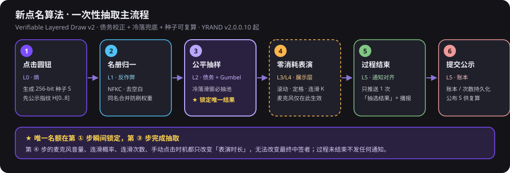
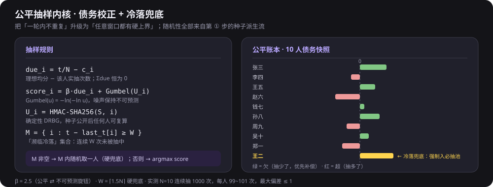
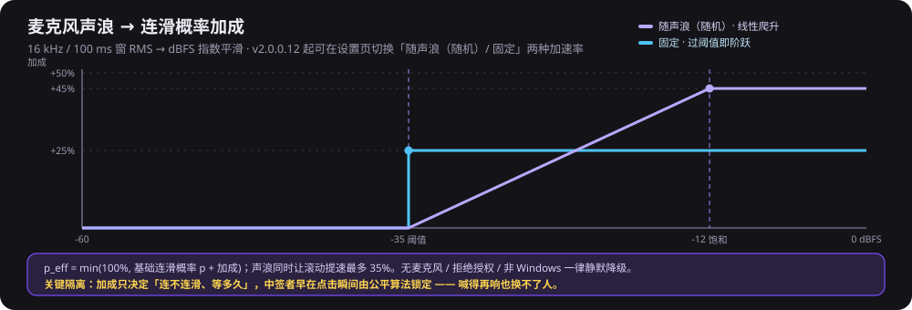

# YRAND

ClassIsland 课堂随机点名插件。点一下圆钮：名字在**同一条提醒上原地滚动换名**，时间到定下一位，按「滑动概率」决定是否连滑，整套过程结束后才推送一次「抽选结果」并语音播报。

> 当前版本 **v2.0.0.16** · 作者 **Ycj1026 与 workbuddy** · [作者与协作者](CONTRIBUTORS.md) · [全部 Release](https://github.com/Ycj1026/YRAND/releases)

## 功能

| 特性 | 说明 |
|---|---|
| 两段式抽选 | 匀速滚动（ease-out 减速）→ 定格 → 概率连滑 → 最终揭晓；中间定格静默、不播报、不消耗名额 |
| 公平算法 v2 | 债务校正 + Gumbel 加权抽样 + 冷落滑窗兜底；N=10 抽 1000 次每人偏差 ≤1 |
| 一次过程一个名额 | 点击瞬间由 256-bit 种子锁定唯一结果，滚动/连滑/音量/点击时机都改变不了中签者 |
| 可验证随机 | 开局公示指纹 `SHA256(S)[0..8]`，结束公布种子 `S`（`settings.json: LastSeedHex`），可复算自证 |
| 麦克风声浪加成 | NAudio 实时 dBFS，随声浪或固定加成影响连滑概率与滚动速度；设置页可配，无设备静默降级 |
| 插件更新提示 | 启动后静默检查更新（走国内发布台 latest.json，无须翻墙）；空闲时才提醒，同一版本一次，抽选中绝不打扰 |
| 匿名用户统计 | 每天首次启动计数一次，无名单/机器名/设备号等任何个人信息；设置页可查累计数、可一键关闭 |
| Fluent 图标 | 宿主内置抽签图标覆盖设置导航、提醒提供方、结果提醒条 |
| 通知时机 | 过程只注册一条通知（原地换名），结束才开「抽选结果」——滚动再快也不重复弹窗 |

## 算法方式

**流程**：`点击 → 生成种子 S → Reserve() 锁定唯一中签者 → 滚动/定格/连滑（零消耗表演）→ 结束 Commit() 推进账本 + 公布 S`

**公平抽样**（`src/ClassIsland.YRAND/Services/FairDrawService.cs`）：

```text
due_i   = t/N − c_i                        应得次数 − 已抽次数
score_i = β·due_i + Gumbel(U_i)            β 默认 2.5；U 来自 HMAC-SHA256(S) 计数器流
M       = { i | t − LastPickedAt_i ≥ W }   W = ⌈γN⌉，γ 默认 1.5（冷落滑窗，硬保证）
pick    = M 非空 ? M 内随机 : argmax(score_i)
```

`Reserve()` 幂等锁定，只有 `Commit()` 推进账本；`PickVisual()` 用同源分布做零消耗视觉取样，「常被看见」与「真被抽中」机会一致。随机流由 `S = CSPRNG(256bit)` 经 HMAC-SHA256 计数器派生，指纹为 `SHA256(S)` 前 4 字节，过程结束后公布 `S` 即可复算整局。

**麦克风声浪**（`MicLevelService.cs` / `YrandHostService.EffectiveContinueChance`）：

```text
dBFS = 20·log10(RMS)                       16 kHz / 100 ms 窗，指数平滑
随声浪： p = p₀ + MicMaxBonus × clamp((dB − T)/(C − T), 0, 1)
固定：   dB ≥ T ? p = p₀ + MicFixedBonus : p₀      （p 封顶 100%）
T = −35 dBFS，C = −12 dBFS
```

`p` 只影响连滑概率与滚动速度（表演时长），**不改变中签者**；无麦克风 / 拒绝授权 / 非 Windows 静默降级。







## 安装

ClassIsland → 插件管理 → 本地安装，选择 [`releases/`](releases/) 下最新的 `.cipx`（覆盖前建议先卸载旧版）；历史版本见 [Releases](https://github.com/Ycj1026/YRAND/releases)。设置项与账本字段见 [`plugin/README.md`](plugin/README.md)。

## 版本历史

每个版本均有独立 Release（含 `.cipx` 附件与完整修改说明）：<https://github.com/Ycj1026/YRAND/releases>

| 版本 | 主题 |
|---|---|
| [2.0.0.9](https://github.com/Ycj1026/YRAND/releases/tag/2.0.0.9) | 通知时机重写（IL 补丁） |
| [2.0.0.10](https://github.com/Ycj1026/YRAND/releases/tag/2.0.0.10) | 公平算法 v2 + 麦克风声浪加成 |
| [2.0.0.11](https://github.com/Ycj1026/YRAND/releases/tag/2.0.0.11) | Fluent 抽签图标标识 |
| [2.0.0.12](https://github.com/Ycj1026/YRAND/releases/tag/2.0.0.12) | 麦克风加成入设置页 |
| [2.0.0.13](https://github.com/Ycj1026/YRAND/releases/tag/2.0.0.13) | 滚动效果回归 · 两段式可见 · 去指纹 |
| [2.0.0.14](https://github.com/Ycj1026/YRAND/releases/tag/2.0.0.14) | 过程状态统一「抽取中」 |
| [2.0.0.15](https://github.com/Ycj1026/YRAND/releases/tag/2.0.0.15) | 修复快速滚动重复弹窗 |
| **[2.0.0.16](https://github.com/Ycj1026/YRAND/releases/tag/2.0.0.16)** | **匿名用户数量统计 + 插件更新提示** · latest |

逐版本说明见 [`docs/changelog/`](docs/changelog/)；在线版本发布台：<https://ade236ccde4e195c4.app.workbuddy.host/?sharecode=UV5IFW4S3E>

## 从源码构建

```bash
dotnet build src/ClassIsland.YRAND/ClassIsland.YRAND.csproj -c Release
python3 scripts/pack.py            # dist/YRAND-<version>.cipx
```

需要 .NET 8 SDK。Avalonia / ClassIsland.PluginSdk 由宿主提供（编译期引用、不随包分发），NAudio 2.2.1 随包携带。CI 见 [`.github/workflows/build.yml`](.github/workflows/build.yml)。

## 许可

[MIT](LICENSE)
